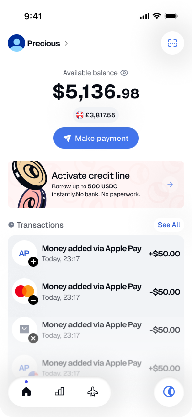
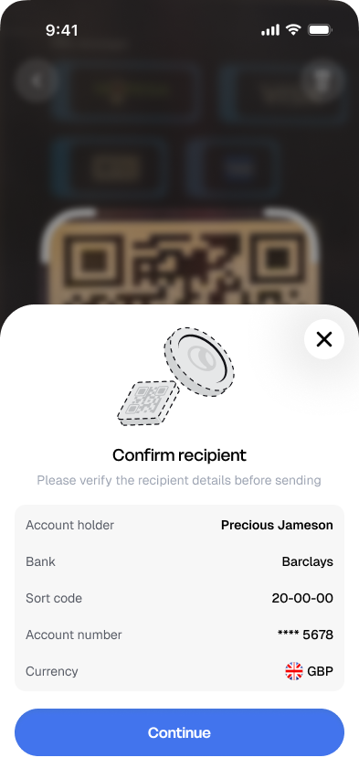
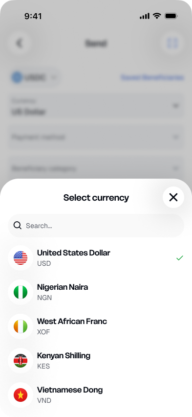
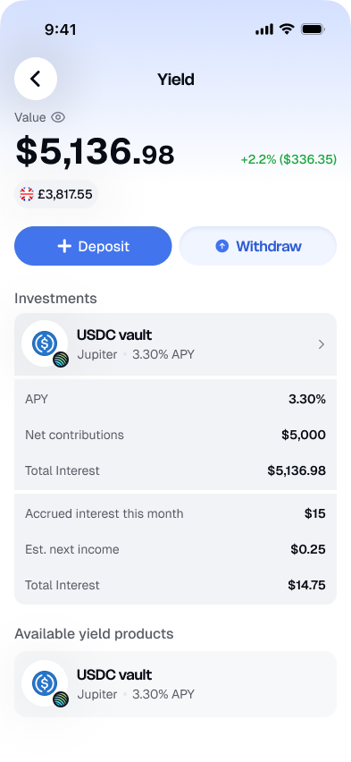

# Owego

**The stablecoin super-app for everyday money, built on Solana.**

Submitted to the Colosseum hackathon. <!-- FILL-IN: hackathon edition name -->

Owego lets people hold dollars as stablecoins and spend them like local money. You sign in with
Google or Apple and get a Solana wallet with no seed phrase to look after. From there you can pay a
bank account in Lagos, an M-Pesa wallet in Nairobi or a Zelle ID in the United States, scan a
merchant QR code in Bangkok or Manila, and earn yield on whatever you keep.

This repository is the mobile app: one React Native codebase for iOS and Android. Wallets are
created through Circle Programmable Wallets, balances are USDC and USDT on Solana, and every
transfer is confirmed with the wallet PIN.

## Links

| Resource   | Link                                            |
| ---------- | ----------------------------------------------- |
| Demo video | <https://www.youtube.com/watch?v=uhEeEHyQiWU>   |
| Website    | <https://www.owego.app/>                        |
| Contact    | [ashley.o@owego.app](mailto:ashley.o@owego.app) |

## Screenshots

|                                                       Home                                                        |                                                   Scan to Pay                                                   |                                                  Send                                                  |                                                  Yield                                                  |
| :---------------------------------------------------------------------------------------------------------------: | :-------------------------------------------------------------------------------------------------------------: | :----------------------------------------------------------------------------------------------------: | :-----------------------------------------------------------------------------------------------------: |
|  |  |  |  |

## Features

### Working today

- [x] Sign in with Google and Apple
- [x] Solana wallet creation with a PIN, through Circle Programmable Wallets (no seed phrase)
- [x] Identity verification (KYC) with Didit
- [x] Home: USDC and USDT balances, a display currency of your choice, hide balance
- [x] Transaction history and details, with a Solscan link for each on-chain transfer
- [x] Receive: deposit address and QR code on Solana and other supported chains
- [x] Direct deposit from a wallet app on the same phone, over Solana Mobile Wallet Adapter
      (Android, including Seeker)
- [x] Send USDC and USDT to a Solana address
- [x] Payouts to Nigerian banks (NGN), M-Pesa in Kenya (KES), Wave and Orange Money in Côte
      d'Ivoire (XOF) and Zelle in the United States (USD)
- [x] Scan to Pay: merchant QR codes in VND, PHP, KHR, IDR, THB, BRL, ARS and COP
- [x] Scan bank account details from a photo (NGN)
- [x] Saved beneficiaries and pay again
- [x] Yield: deposit and withdraw USDC in Jupiter Lend vaults
- [x] Sign-in PIN, biometric unlock and app lock
- [x] Push notifications and notification preferences
- [x] Settings: light and dark appearance, change wallet PIN, support, delete account

### Not finished yet

- [ ] Credit (score and loans): screens built, partner integration pending
- [ ] Travel (eSIM and insurance): screens built, partner integration pending
- [ ] Referrals: screens built, backend not wired
- [ ] Investments in the Wealth tab
- [ ] Fiat deposits: bank transfer, card, Apple Pay and Google Pay, Cash App, PayPal
- [ ] Statements
- [ ] Virtual cards

A feature is listed as working when it is wired to the backend or to the vendor SDK. Unfinished
features that already have screens are hidden in the app or marked "Coming soon".

## Built with

- **Solana** for balances and transfers in USDC and USDT
- **Circle Programmable Wallets** for PIN-secured wallets and transaction signing
- **Solana Mobile Wallet Adapter** for deposits from a wallet on the device
- **Jupiter Lend** for yield
- **Didit** for identity verification
- **Firebase Cloud Messaging** for push notifications
- **React Native 0.86**, React 19 and TypeScript, with React Navigation, TanStack Query, Zustand
  and zod
- **Jest**, React Native Testing Library and MSW for tests

Android builds are signed for both Google Play and the Solana dApp Store.

## How it is built

- **Feature slices.** Each feature in `src/features/` has its own `data`, `domain` and
  `presentation` layers. The domain imports nothing from the other two, and no feature imports
  another. CI enforces both rules.
- **Money is never a float.** Amounts are integer minor units or the decimal string the API sent.
- **Nothing from outside is trusted.** Every network response, deep link, QR code and push payload
  is parsed with a zod schema before the app uses it.
- **Test first.** The repository has 400 test files. `npm run verify` runs the type check, lint,
  the layer rules, type coverage and the whole suite.

## Getting started

```bash
npm install
npm run verify   # needs no credentials
```

Running the app on a simulator or a phone needs configuration and credentials that are not in this
repository. The [installation guide](docs/installation.md) lists them and walks through the setup.

## License

Copyright © 2026 Owego. All rights reserved.

This code is **not open source**. It is public so that it can be reviewed as a hackathon
submission: you may read it and run it locally to evaluate it, and nothing else. See
[LICENSE](LICENSE) for the terms.
